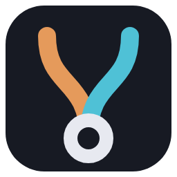
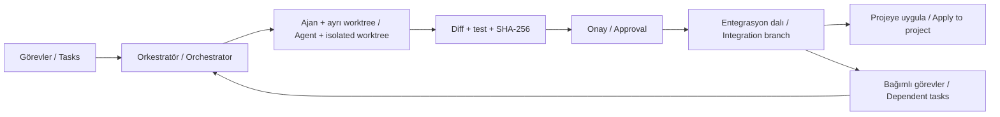

<div align="center">



# AgentMesh

**Bir proje. Birden fazla ajan. Kontrol sizde.**<br>
**One project. Multiple agents. You stay in control.**

Git worktree tabanlı, yerel çoklu ajan masaüstü IDE’si.<br>
A local desktop IDE for coordinating coding agents through Git worktrees.

[Türkçe](#türkçe) · [English](#english)

</div>

---

## Türkçe

### AgentMesh nedir?

AgentMesh; Codex, Claude Code, OpenCode, Antigravity ve GitHub Copilot gibi kodlama ajanlarını aynı projede yönetmenizi sağlayan bir masaüstü uygulamasıdır. Bir ajana uygulamayı geliştirmesini, diğerine testleri hazırlamasını, üçüncüsüne ise tamamlanan işleri incelemesini verebilirsiniz.

Her görev kendi **Git dalında ve worktree’sinde** yürür. Bağımsız görevler paralel çalışır; birbirine bağlı görevler onaylanan sonuçları bekler. Normal modda değişiklikleri diff üzerinden inceler, onaylar ve projenize ne zaman uygulanacağına siz karar verirsiniz.

> **Durum: aktif geliştirme / çalışan prototip (v0.1.0).** Windows odaklıdır. Sağlayıcı desteği, izinler ve model erişimi kullanılan adaptöre ve yerel kuruluma göre değişir.

### Öne çıkan özellikler

- **Çoklu ajan çalışma akışı:** Farklı sağlayıcıları tek projede kullanın; görev başına ajan ve model seçin.
- **Paralel ve bağımlı görevler:** 1–8 paralel ajanla çalışın; örneğin incelemeyi uygulama ve test görevlerine bağlayın.
- **Git ile izolasyon:** Görevler ayrı çalışma alanlarında yürür. Onaylı değişiklikler önce entegrasyon dalında birikir.
- **İnceleme ve birleştirme:** Diff, SHA-256 içerik özeti, test sonuçları ve birleştirme akışı üzerinden değişiklikleri denetleyin.
- **Ortak proje bağlamı:** Görev sonuçları, kararlar ve ajanlar arası mesajlar sonraki görevlere aktarılır.
- **Görev devri:** Durdurulmuş veya başarısız görevi başka ajana verin; yeni ajan aynı worktree’de kalan değişikliklerden devam etsin.
- **IDE araçları:** Dosya gezgini, Monaco editörü, terminal, ajan akışı, etkinlik paneli ve görev denetçisi.
- **Yerel kayıt:** Görevler, olaylar ve proje bağlamı SQLite günlüğünde saklanır.
- **İsteğe bağlı Full Mode:** Desteklenen izinleri ve değişiklik onaylarını otomatikleştirin.

### Gereksinimler ve kurulum

- Windows; mevcut paketleme hedefi Windows x64’tür.
- Node.js **22.12 veya üzeri**, npm ve Git.
- Gerçek görevler için en az bir desteklenen ajan ve o ajanın gerektirdiği giriş/API yapılandırması. Yerel demo model çağırmaz.

```powershell
git clone https://github.com/leongrphc/AgentMesh.git
cd AgentMesh
npm ci
npm run desktop
```

Uygulama son projenizi yeniden açar; kayıtlı proje yoksa karşılama ekranını gösterir. Demo ile gerçek model çağırmadan iş akışını deneyebilirsiniz.

### İlk görevden birleştirmeye

1. **Klasör aç…** ile projenizi seçin. Git deposu değilse AgentMesh depo oluşturur ve mevcut dosyaları ilk commit’e alır; bağımlılık/build çıktıları ve `.env` dosyaları hariç tutulur. Mevcut depolarda önce değişikliklerinizi commit edin: ajanlar son commit’ten başlar.
2. **Ajanlar** penceresinde sağlayıcıları, modelleri ve gerekiyorsa Codex profilini seçin. Ajanın kendi CLI girişini/yapılandırmasını tamamlayın ve bağlantısını kontrol edin.
3. **＋ Yeni görev** ile başlık, talimat ve ajan seçin. İsterseniz bağımlılıklar tanımlayın veya plan oluşturma akışını kullanın.
4. **▶ Ajanları başlat** düğmesine basın. Görevler `.agentmesh/worktrees/` altında kendi dallarında yürür; ilerleme etkinlik panelinde görünür.
5. Görev inceleme beklediğinde **Değişiklikleri incele → Onayla ve birleştir** yolunu izleyin. Onaylı işler `agentmesh/integration-…` dalında birikir.
6. **Projeme uygula** ile entegrasyon sonucunu projenizin açık dalına alın. Çakışmada otomatik uygulama durur; değişiklikler zorla birleştirilmez.

Proje verileri seçtiğiniz klasörün `.agentmesh/` dizininde tutulur. AgentMesh bu dizini `.git/info/exclude` ile Git’ten gizler. `Ctrl+B` görev panelini, `Ctrl+J` alt paneli açıp kapatır.

### Sağlayıcılar

| Sağlayıcı | Bağlantı ve önemli noktalar |
| --- | --- |
| Codex | CLI / App Server; yerel giriş ve ayrı `CODEX_HOME` profilleri. App Server araç izinlerini arayüze iletebilir. |
| Claude Code | Headless CLI; kendi girişi veya `ANTHROPIC_API_KEY`. Dosya kapsamı ve komut kuralları adaptör tarafından uygulanır. |
| OpenCode | CLI / HTTP Server. Server bağlantısı etkileşimli izinleri destekler; model erişimi yerel OpenCode yapılandırmasına bağlıdır. |
| Antigravity | Headless CLI. Araç ve izin davranışı native CLI’nin yeteneklerine bağlıdır. |
| GitHub Copilot | Resmî SDK ve onunla eşleşen native CLI; yerel GitHub girişi kullanılır. Dosya araçları görev kapsamıyla sınırlıdır; shell, MCP ve ağ araçları kapalıdır. |

AgentMesh bir model aboneliği sağlamaz. Gerçek ajan çalıştırmaları seçtiğiniz sağlayıcının kota, ücretlendirme ve erişim koşullarına tabidir. Sağlayıcıların tümü aynı izin ve oturum yeteneklerini sunmaz.

### Full Mode

Üst bardaki **Full Mode** seçimi proje bazında saklanır. Açıldığında desteklenen araç izinleri tek kullanımlık otomatik onaylanır; görev değişiklikleri entegrasyon dalına alınır, bağımlı görevler devam eder ve tüm işler tamamlanınca sonuç projeye otomatik uygulanır. Plan penceresinde planı kabul etme ve görevleri başlatma adımları da otomatikleşir.

**Bu mod komutların ek soru olmadan çalışmasına ve proje dosyalarının otomatik değişmesine izin verir.** Yalnızca güvendiğiniz projelerde kullanın. Dosya kapsamı, sağlayıcının sandbox sınırları, içerik özeti ve temiz Git çalışma alanı kontrolleri korunur. Desteklenmeyen sağlayıcı izinleri açılmaz. Başarısız test, bağlam/birleştirme çakışması veya hata akışı durdurur. Çalışma sürerken mod değiştirilemez; **Durdur** ile iptal edebilirsiniz.

### Nasıl çalışır?



Normal modda onay kullanıcıdan gelir; Full Mode desteklenen adımları otomatikleştirir. Orkestratör görev bağımlılıklarını ve durumlarını yönetir; kodu değiştiren bileşen seçilen ajandır.

### Geliştirme ve komutlar

| Komut | Açıklama |
| --- | --- |
| `npm run desktop` | Masaüstü uygulamasını derler ve açar. |
| `npm test` | Otomatik testleri çalıştırır; gerçek model çağırmaz. |
| `npm run typecheck` | TypeScript tip kontrolü yapar. |
| `npm run desktop:smoke` | Gerçek Electron penceresinde arayüz smoke testi; model çağırmaz. |
| `npm run demo` | CLI üzerinden yerel demo çalıştırır. |
| `npm run live -- --config <dosya>` | Config tabanlı CLI çalıştırması. |
| `npm run e2e:claude` | Gerçek Claude ile görev → inceleme → birleştirme testi. |
| `npm run e2e:codex -- codex1` | Gerçek Codex ile test; profil adı isteğe bağlıdır. |
| `npm run e2e:team -- claude codex:codex1` | İki paralel ajan ve sonuçlarına bağlı üçüncü görev. |
| `npm run desktop:package` | `dist/releases` altında taşınabilir Windows paketi oluşturur. |
| `npm run desktop:installer` | `dist/installers/AgentMesh-Setup-<sürüm>.exe` üretir. |

`e2e:*` komutları gerçek sağlayıcı çağrıları yapar ve kota/ücret tüketebilir. Kaynak yapı: `desktop/` React arayüzü, `src/desktop/` Electron ve yerel servisler, `src/core/` orkestrasyon/Git/kayıt, `src/adapters/` sağlayıcı bağlantıları, `tests/` testler, `docs/` ayrıntılı belgeler.

### Sınırlar, belgeler ve katkı

Bu sürüm üretim olgunluğunda değildir. macOS/Linux paketleri doğrulanmış dağıtım hedefleri değildir. Windows kurulum dosyası imzasızdır ve SmartScreen uyarısı gösterebilir; otomatik güncelleme henüz yoktur. İzinler sağlayıcıya göre değişir; test komutunuzu proje ayarlarında tanımlayın. Ortak proje bağlamı ve görev talimatları seçilen sağlayıcıya gönderilebilir; “yerel” ifadesi masaüstü uygulamasının ve kayıtlarının yerel olmasını anlatır.

- [Ayrıntılı başvuru ve CLI](docs/reference.md)
- [Mimari](docs/architecture.md) · [Ajan protokolü](docs/agent-protocol.md)
- [İzinler](docs/permissions.md) · [Birleştirme ve inceleme](docs/merge-review.md)
- [Sağlayıcı notları](docs/providers.md) · [Yol haritası](docs/TASKS.md)

Belgelerin bazıları önceki geliştirme aşamalarına ait notlar içerir; mevcut davranış için kaynak kodu ve testleri de inceleyin. Hata bildirirken yeniden üretim adımlarını, işletim sistemi/Node sürümünü ve sağlayıcıyı ekleyin. Loglardan anahtar ve kişisel bilgileri çıkarın. Katkı için odaklı bir pull request açın; ilgili testleri ve tip kontrolünü çalıştırın.

Depoda henüz bir lisans dosyası bulunmuyor. Herkese açık erişim, açık kaynak lisansı verildiği anlamına gelmez.

---

## English

### What is AgentMesh?

AgentMesh is a desktop application for coordinating coding agents such as Codex, Claude Code, OpenCode, Antigravity, and GitHub Copilot in the same project. Assign implementation to one agent, tests to another, and review to a third.

Each task runs in its own **Git branch and worktree**. Independent tasks run in parallel; dependent tasks wait for approved results. In normal mode, you review the diff, approve changes, and decide when to apply them to your project.

> **Status: active development / working prototype (v0.1.0).** Windows-focused. Provider support, permissions, and model access depend on the adapter and your local setup.

### Features

- **Multiple providers:** Use different coding agents in one project; choose an agent and model per task.
- **Parallel tasks and dependencies:** Run 1–8 agents concurrently and make review depend on implementation and tests.
- **Git isolation:** Tasks run in separate worktrees. Approved changes accumulate in an integration branch.
- **Review and merging:** Inspect diffs, SHA-256 content digests, test results, and merge outcomes.
- **Shared project context:** Pass task results, decisions, and messages to subsequent tasks.
- **Task handoff:** Reassign a stopped or failed task; the next agent continues from the changes in the same worktree.
- **IDE tools:** File explorer, Monaco editor, terminal, agent stream, activity panel, and task inspector.
- **Local persistence:** Tasks, events, and project context are stored in a SQLite journal.
- **Optional Full Mode:** Automate supported permission requests and change approvals.

### Requirements and installation

- Windows; the current packaging target is Windows x64.
- Node.js **22.12 or later**, npm, and Git.
- At least one supported agent with its required authentication/API configuration for real tasks. The local demo does not call a model.

```powershell
git clone https://github.com/leongrphc/AgentMesh.git
cd AgentMesh
npm ci
npm run desktop
```

The app reopens your last project, or shows a welcome screen when no saved project is available. Use the demo to explore the workflow without calling a real model.

### From first task to merged changes

1. Open your project with **Klasör aç…** (Open folder). For a folder without Git, AgentMesh initializes a repository and commits existing files, excluding dependency/build outputs and `.env` files. For an existing repository, commit your changes first: agents start from the latest commit.
2. Open **Ajanlar** (Agents) to choose providers, models, and a Codex profile if needed. Complete the agent’s own CLI authentication/configuration and check the connection.
3. Choose **＋ Yeni görev** (New task), enter a title and instructions, and select an agent. Add dependencies or use the planning workflow.
4. Click **▶ Ajanları başlat** (Start agents). Tasks run on their own branches under `.agentmesh/worktrees/`; progress appears in the activity panel.
5. When a task awaits review, use **Değişiklikleri incele → Onayla ve birleştir** (Review changes → Approve and merge). Approved work accumulates in an `agentmesh/integration-…` branch.
6. Click **Projeme uygula** (Apply to my project) to bring the integration result into your current project branch. Conflicts stop automatic application; changes are never force-merged.

Project data lives in the selected folder’s `.agentmesh/` directory, excluded from Git through `.git/info/exclude`. `Ctrl+B` toggles the task panel; `Ctrl+J` toggles the bottom panel. The labels above reflect the current Turkish UI.

### Providers

| Provider | Connection and considerations |
| --- | --- |
| Codex | CLI / App Server; local authentication and separate `CODEX_HOME` profiles. App Server can forward tool permission requests to the UI. |
| Claude Code | Headless CLI; its own login or `ANTHROPIC_API_KEY`. The adapter enforces file scope and command rules. |
| OpenCode | CLI / HTTP Server. The server connection supports interactive permissions; model access depends on local OpenCode configuration. |
| Antigravity | Headless CLI. Tool and permission behavior depends on native CLI capabilities. |
| GitHub Copilot | Official SDK and matching native CLI, using local GitHub authentication. File tools are task-scoped; shell, MCP, and network tools are disabled. |

AgentMesh does not include a model subscription. Real agent runs use your provider’s quotas, billing, and access terms. Permission and session capabilities differ across providers.

### Full Mode

The **Full Mode** toggle is saved per project. When enabled, supported tool permissions receive automatic one-time approval; task changes merge into the integration branch, dependent tasks continue, and the final result is applied to your project after all tasks complete. The planning dialog also automates plan acceptance and task startup.

**This mode allows commands to run without additional prompts and project files to change automatically.** Use it only with projects you trust. File scope, provider sandbox boundaries, content digests, and clean Git working-tree checks remain in place. Unsupported provider permissions are not enabled. Failed tests, context/merge conflicts, and errors stop the workflow. The mode cannot be changed during a run; use **Durdur** (Stop) to cancel.

### How it works

The diagram in the Turkish section shows the shared workflow: tasks → orchestrator → agent in an isolated worktree → diff/tests/content digest → approval → integration branch. Approved code becomes the starting point for dependent tasks and can be applied to the project branch.

Normal mode requires user approval; Full Mode automates supported steps. The orchestrator manages task states and dependencies, while the selected agent performs the coding work.

### Development commands

| Command | Purpose |
| --- | --- |
| `npm run desktop` | Build and launch the desktop app. |
| `npm test` | Run automated tests without real model calls. |
| `npm run typecheck` | Check TypeScript types. |
| `npm run desktop:smoke` | Run a UI smoke test in a real Electron window, without model calls. |
| `npm run demo` | Run the local CLI demo. |
| `npm run live -- --config <file>` | Run the config-based CLI. |
| `npm run e2e:claude` | Real Claude task → review → merge test. |
| `npm run e2e:codex -- codex1` | Real Codex test; profile name is optional. |
| `npm run e2e:team -- claude codex:codex1` | Two parallel agents followed by a task depending on their results. |
| `npm run desktop:package` | Create a portable Windows package under `dist/releases`. |
| `npm run desktop:installer` | Build `dist/installers/AgentMesh-Setup-<version>.exe`. |

The `e2e:*` commands call real providers and can consume quota or incur charges. Source layout: `desktop/` contains the React UI, `src/desktop/` Electron and local services, `src/core/` orchestration/Git/persistence, `src/adapters/` provider integrations, `tests/` tests, and `docs/` detailed documentation.

### Limitations, documentation, and contributing

This release is a prototype. macOS/Linux packages are not validated distribution targets. The Windows installer is unsigned and may trigger SmartScreen; automatic updates are not implemented. Permission behavior varies by provider; configure your project test command in project settings. Shared context and task instructions may be sent to the selected provider: “local” describes the desktop application and its stored records.

- [Detailed reference and CLI](docs/reference.md)
- [Architecture](docs/architecture.md) · [Agent protocol](docs/agent-protocol.md)
- [Permissions](docs/permissions.md) · [Merge review](docs/merge-review.md)
- [Provider notes](docs/providers.md) · [Roadmap](docs/TASKS.md)

The detailed documentation is primarily in Turkish. Some documents retain notes from earlier development stages; consult current source and tests for implementation details. When reporting bugs, include reproduction steps, OS/Node versions, and provider details. Remove credentials and personal data from logs. For contributions, open a focused pull request and run relevant tests and type checking.

There is currently no license file in this repository. Public visibility does not grant an open-source license.
